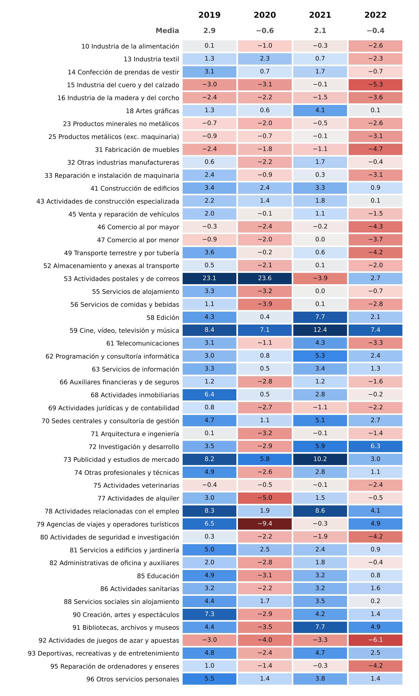
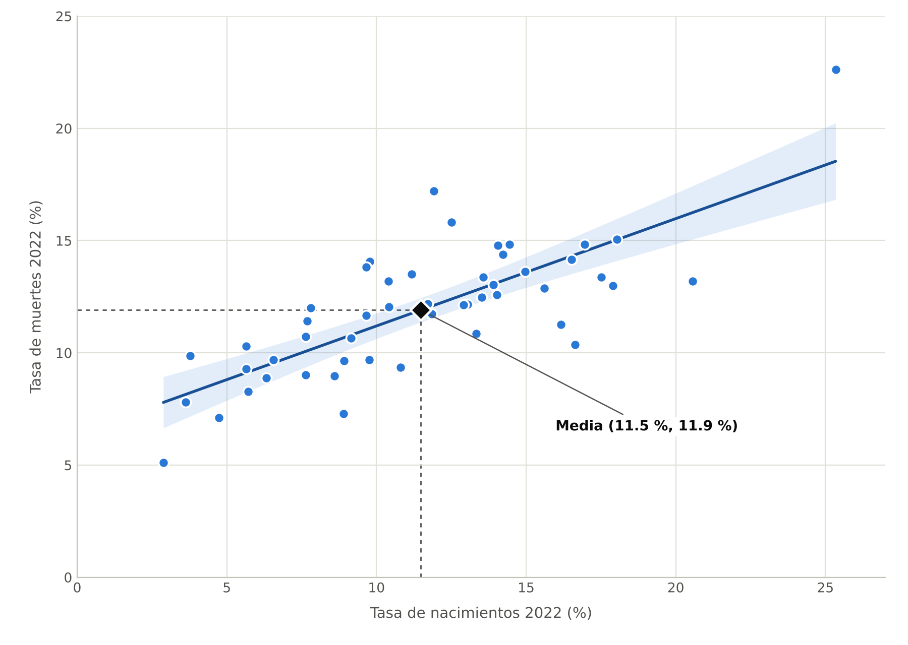

# Analysis_self_employed_Spain
Which sectors create and which destroy self-employed businesses (*autónomos*) in Spain?

| Requirements | Skills |
|--------------|--------|
| - `python3.10+`<br> - `Pandas`<br> - `Numpy`<br> - `Matplotlib`<br> - `scikit-learn`<br> - `SciPy`<br> - `excel`<br> - `Jupyter`<br> | - `Data extracting`<br> - `Data cleaning and transformation`<br> - `Data wrangling`<br> - `Data visualization`<br> - `Linear regression`<br> - `Data Analysis` |

## Introduction

### Report objective
The objective of the analysis is to identify which economic sectors gain and which lose self-employed businesses in Spain between 2019 and 2022, and to check whether the sectors where more people start a business are also the ones where more people close it.

### What is a self-employed business
INE classifies active businesses by legal form (*condición jurídica*). Businesses owned by a natural person (*personas físicas*) are the sole proprietors commonly called *autónomos*. In 2022 there were 2,089,250 of them, 59.9 % of the 3,487,503 active businesses in Spain.

This is the business-register view of self-employment, so it does not match exactly the Social Security (RETA) affiliation figures.

### Indicators
For every CNAE 2009 division and year:

- **Birth rate** = births / active businesses × 100
- **Death rate** = deaths / active businesses × 100
- **Net rate** = birth rate − death rate. Positive: the sector gains self-employed businesses; negative: it loses them.

## General Analysis

### National trend
1. Self-employment alternates between net creation and net destruction: **+2.39 %** in 2019, **−0.98 %** in 2020, **+1.50 %** in 2021 and **−1.05 %** in 2022.
2. The 2020 drop came from a collapse in births (birth rate from 12.5 % to 9.3 %, lower in 49 of the 50 sectors analysed) while deaths barely moved (10.1 % → 10.3 %). The 2022 drop is the opposite: the death rate rose from 9.2 % to 11.1 % and went up in 48 of the 50 sectors.

### Net rate by sector
1. Creative, digital and business services gained self-employed businesses **every year**: film, video, TV and music (59), advertising (73), employment activities (78), IT programming and consulting (62), management consulting (70), publishing (58), plus building construction (41, 43) and personal services (96).
2. Traditional manufacturing and trade lost them **every year**: leather and footwear (15), wood (16), furniture (31), metal products (25), non-metallic minerals (23), wholesale (46) and retail (47). So did veterinary activities (75) and gambling (92).
3. The pandemic hit tourism and leisure hardest in 2020: travel agencies −9.4 %, renting −5.0 %, food and beverage service −3.9 % and accommodation −3.2 %. 33 of the 50 sectors were negative that year, against 9 in 2019.
4. Postal and courier activities (53) had net rates of **+23 %** in 2019 and 2020 and fell to −3.9 % in 2021, coinciding with the "Ley Rider" (Royal Decree-law 9/2021, in force since 12 August 2021), which presumes that delivery-platform riders are employees, not self-employed.
5. 2022 was negative in 28 of the 50 sectors. Travel agencies recovered (+4.9 %), while gambling (−6.1 %), leather and footwear (−5.3 %) and furniture (−4.7 %) had their worst year.

*Red: the sector lost self-employed businesses that year (net rate < 0). Blue: it gained them. Each cell shows the net rate (%); the **Media** row is the simple average of the 50 sectors.*



### Do sectors with more births also have more deaths? Linear regression
1. Yes. Across the 50 sectors, the death rate rises with the birth rate: **deaths = 6.41 + 0.48 × births** (2022, R² = 0.59, p < 0.001). Sectors with many new self-employed businesses, such as postal and courier activities or film and TV, also close many of them: high turnover, not only growth.
2. Each extra point of birth rate comes with about half a point more of death rate. According to the fitted line, a sector only gains self-employed businesses in net terms when its birth rate is above **≈12.3 %**, the point where predicted deaths equal births.
3. The relationship holds every year, although it was weaker in 2020, when births collapsed in almost every sector. The break-even birth rate went up from 9.3 % in 2019 to 12.3 % in 2022: in 2022 sectors needed more births just to stay level.

| Year | Slope | Intercept | R² | Break-even birth rate |
|------|-------|-----------|----|-----------------------|
| 2019 | 0.36 | 5.99 | 0.62 | 9.3 % |
| 2020 | 0.32 | 7.71 | 0.37 | 11.4 % |
| 2021 | 0.52 | 3.70 | 0.57 | 7.7 % |
| 2022 | 0.48 | 6.41 | 0.59 | 12.3 % |

*Each dot is a CNAE division in 2022. The line is the OLS fit with its 95 % confidence band; the black diamond marks the mean (11.5 % births, 11.9 % deaths), a point the regression line always passes through.*



### Methodology notes
- Charts only include the 50 CNAE divisions with at least 1,000 self-employed businesses every year (99.6 % of all self-employed businesses in 2022). In tiny sectors one birth or death moves the rate by tens of points: coke and refined petroleum products has 1 self-employed business and a net rate of −100 % in 2022. The full table for the 81 divisions is in `data/processed/por_sector.xlsx`.
- The regression is cross-sectional (one point per sector). With only four years, one of them the pandemic, a time trend per sector would not be reliable.
- Deaths are INE's provisional deaths.

## Project structure
```
Analysis_self_employed_Spain/
├── data/
│   ├── raw/                          # INE CSV files: stock, births and deaths 2019-2022
│   └── processed/
│       ├── por_sector.xlsx           # net rate by sector and year (same output as the notebook)
│       ├── autonomos_por_sector.csv  # tidy dataset used by the charts
│       └── regresion_por_anio.csv    # regression results by year
├── assets/                           # charts used in this README
├── notebooks/
│   └── autonomos-espania.ipynb       # original exploratory notebook
├── autonomos_espania.py              # notebooks/autonomos-espania.ipynb as a script: raw CSV -> data/processed
├── utilities.py                      # chart helpers: data loading, labels, colors and style
├── heatmap_tasa_neta.py              # color scale heatmap -> assets/heatmap_tasa_neta.png
├── regresion_lineal.py               # linear regression -> assets/regresion_lineal.png
├── requirements.txt
└── LICENSE
```

## How to run
```bash
pip install -r requirements.txt

python autonomos_espania.py   # 1. reads data/raw and writes data/processed
python heatmap_tasa_neta.py   # 2. heatmap (add --mostrar to open the matplotlib window)
python regresion_lineal.py    # 3. linear regression (add --mostrar to open the window)
```

## Resources
- [INE - Demografía armonizada de empresas: stock, nacimientos y muertes de empresas](https://ine.es/dynt3/inebase/es/index.htm?padre=6103)
- [Ley Rider - Real Decreto-ley 9/2021 (Garrigues)](https://www.garrigues.com/es_ES/noticia/entra-vigor-ley-rider-nuevas-exigencias-laborales-plataformas-digitales-reparto)
